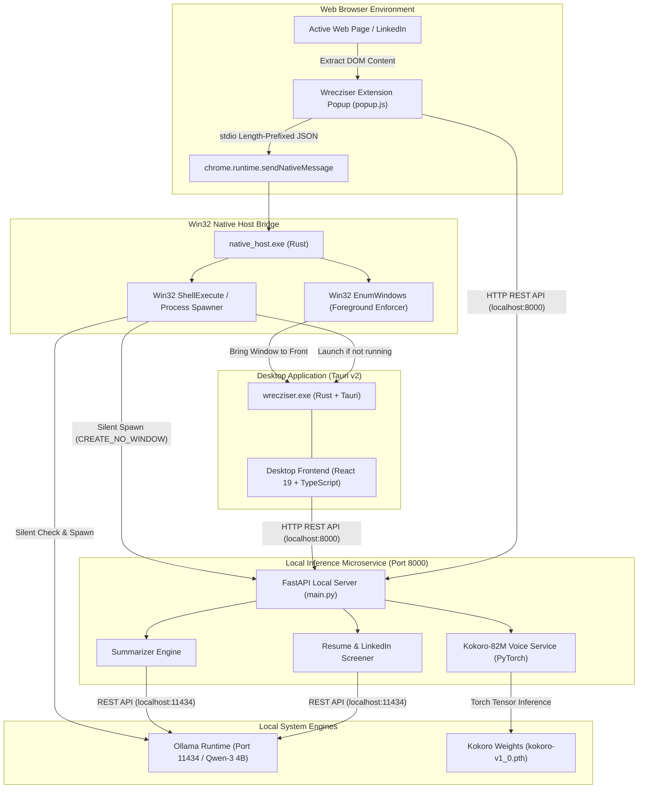
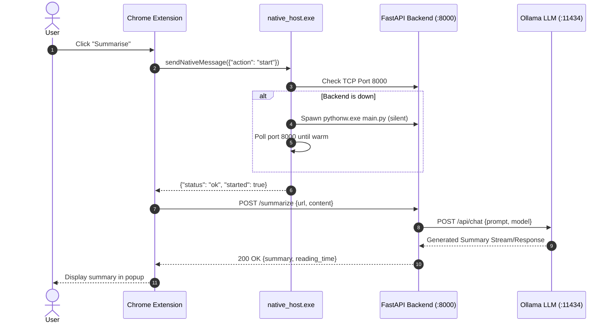
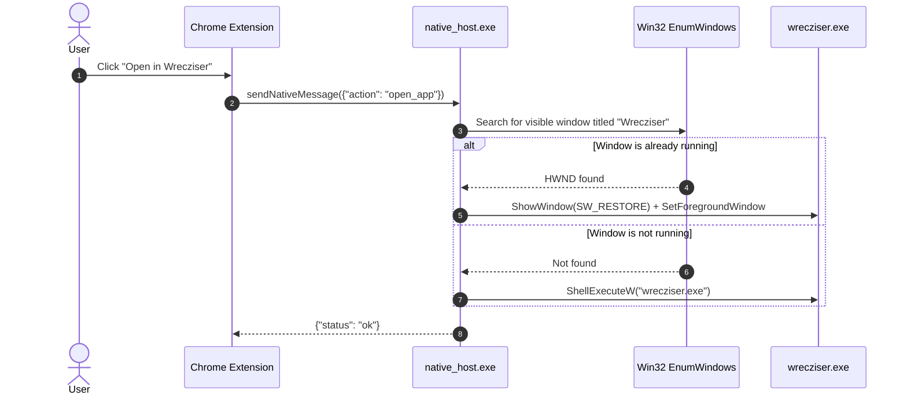

# Wrecziser System Architecture 🏛️

This document describes the high-level architecture, component hierarchy, process lifecycle, communication protocols, and security boundaries of the **Wrecziser** ecosystem.

---

## 1. Architectural Overview & Design Principles

Wrecziser is architected as a **hybrid local system** combining browser automation, lightweight Win32 native messaging, an asynchronous Python microservice, and a modern Tauri-based desktop user interface.

### Core Principles
1. **100% Local & Privacy-First**: Zero telemetry, external API calls, or cloud transmissions. Summaries, candidate analyses, and neural voice synthesis run entirely on-device via Ollama and PyTorch/Kokoro.
2. **Zero Idle Overhead (Daemonless)**: No persistent background processes consume CPU or RAM when the application is idle. The backend services spin up silently on-demand only when a user triggers an action.
3. **Decoupled Modularity**: The Chrome Extension, Native Messaging Host, FastAPI Backend, and Tauri Desktop Window can each be developed, tested, or recompiled independently.
4. **Single-Instance Window Hygiene**: If the desktop application is already running, triggering "Open in Wrecziser" locates the existing window via Win32 API and restores it to the foreground rather than launching duplicate instances.

---

## 2. High-Level System Architecture Diagram

---

## 3. Component Hierarchy & Responsibilities

### A. Chrome Extension (Manifest V3)
- **Role**: Client interface embedded in Chromium browsers.
- **Key Modules**:
  - `popup.html` / `popup.js`: User interface for triggering tasks (Summarise, LinkedIn Analysis, Resume Targeting), reading instant previews, downloading TXT summaries, and launching the desktop app.
  - `scripting.executeScript`: Injects lightweight scraping routines into the active tab to extract article body text or structured LinkedIn job descriptions.
  - `nativeMessaging`: Dispatches IPC messages to `com.wrecz.wrecziser` to warm up services and launch the desktop window.

### B. Native Messaging Host (`native_host.exe`)
- **Role**: Lightweight bridge between the browser sandbox and the host operating system.
- **Language**: Rust (`native_host.rs`), compiled with `#![windows_subsystem = "windows"]` to ensure zero console window flash.
- **Key Responsibilities**:
  - Reads standard input using Chrome's 32-bit little-endian length-prefixed protocol.
  - Checks if FastAPI (`127.0.0.1:8000`) is active; if down, spawns `.venv\Scripts\pythonw.exe main.py` using `CREATE_NO_WINDOW` and `DETACHED_PROCESS`.
  - Checks if the desktop app (`wrecziser.exe`) is already open using Win32 `EnumWindows` and `GetWindowTextW`. If found, restores and brings it to the foreground (`ShowWindow(SW_RESTORE)`, `SetForegroundWindow`).
  - If not running, launches `wrecziser.exe` via `ShellExecuteW`.
  - Sends a standard JSON response back to Chrome before cleanly exiting.

### C. Backend Microservice (`Wrecziser backend`)
- **Role**: High-performance local API orchestrator.
- **Framework**: FastAPI (Asynchronous Python 3.10+).
- **Key Services**:
  - `main.py`: Exposes `/summarize`, `/health`, `/api/summary`, `/api/linkedin/analyze`, `/api/resume/target`, and `/api/voice/synthesize`.
  - `summarizer.py`: Content cleaning, chunking, and prompt synthesis.
  - `ollama_client.py`: Async client managing chat completions with Ollama (`qwen3:4b-instruct-2507-q4_K_M`). Features native GPU hardware profiling (`nvidia-smi` / CUDA), dynamic 3-tier VRAM scaling (4K/8K/16K tokens), tensor-core batch acceleration (`num_batch: 1024`), full layer GPU offloading (`num_gpu: 99`), and hot VRAM pinning (`keep_alive: 30m`).
  - `voice_service.py`: 82M-parameter Kokoro TTS pipeline with CPU thread optimization, voice bank caching (`am_fenrir`, `af_heart`), and phoneme mapping.
  - `screener_service.py` & `document_extractor.py`: PDF/DOCX ingestion and semantic qualification matching.

### D. Desktop Application (`Wrecziser-Window-frontend` / `wrecziser.exe`)
- **Role**: Dedicated desktop workspace for comprehensive reading, audio playback, document upload, and candidate tracking.
- **Framework**: Tauri v2 (Rust desktop host + React 19 + TypeScript + Vite + Tailwind CSS).
- **Features**:
  - Frameless modern window design with custom drag regions.
  - Dynamic fallback: If launched directly by the user (outside the Chrome extension), the Tauri host checks `127.0.0.1:8000` on startup and silently spawns the backend if not detected.

### E. Standalone Self-Extracting Installer (`Setup.exe` / `installer/`)
- **Role**: Zero-dependency, single-file installer that autonomously sets up and configures the complete Wrecziser stack on any clean Windows machine.
- **Framework**: Tauri v2 + Rust backend with an embedded DEFLATE application payload (`payload.zip`, 5.34MB).
- **Key Architectural Features**:
  - **Thread-Isolated Execution**: The entire setup pipeline executes on an isolated background OS worker thread (`std::thread::spawn`), preventing UI blocking and guaranteeing instantaneous window controls (`minimize_installer`, `close_installer`).
  - **Dual Progress Synchronization**: The frontend UI listens to native `install-progress` events while simultaneously polling `get_install_state` every 250ms via core IPC, ensuring progress updates never freeze regardless of webview lifecycle.
  - **Resilient Downloader**: Uses native Windows `curl.exe` with a TLS 1.2 / TLS 1.3 PowerShell fallback to download Python 3.11, Ollama, and Kokoro weights reliably on clean Windows 10/11 installations.
  - **Automated Notepad Guide**: Generates `CHROME_EXTENSION_SETUP.txt` containing the user's exact folder path and automatically opens it in Windows Notepad upon installation completion.

---

## 4. Sequence & Process Flow

### Scenario 1: Extension-Triggered Summarization

### Scenario 2: Opening the Desktop Window

---

## 5. Security & Isolation Boundaries

- **Localhost Binding**: All networking interfaces (`FastAPI` at `:8000` and `Ollama` at `:11434`) bind exclusively to loopback IPv4 (`127.0.0.1`). External incoming connections from the local LAN or WAN are rejected.
- **Native Host Access Control**: Chrome restricts native messaging host invocation strictly to extensions specified in `allowed_origins` inside `com.wrecz.wrecziser.json`. Unauthorized extensions or arbitrary applications cannot invoke `native_host.exe`.
- **Zero External Egress**: No user documents, scraped web content, summaries, or synthesized audio streams are transmitted beyond the local file system and memory.

---

## 6. Target Platforms & CPU Architectures

| Architecture | Platform | Status | Build Output |
| :--- | :--- | :--- | :--- |
| **x86_64 / AMD64** | Windows 10 & 11 (64-bit) | **Primary Target** | `native_host.exe`, `wrecziser.exe` |
| **ARM64** | Windows on ARM (Surface Pro X, etc.) | Compatible via Windows x64 Emulation (or native rebuild) | Compiled via `cargo build --target aarch64-pc-windows-msvc` |
