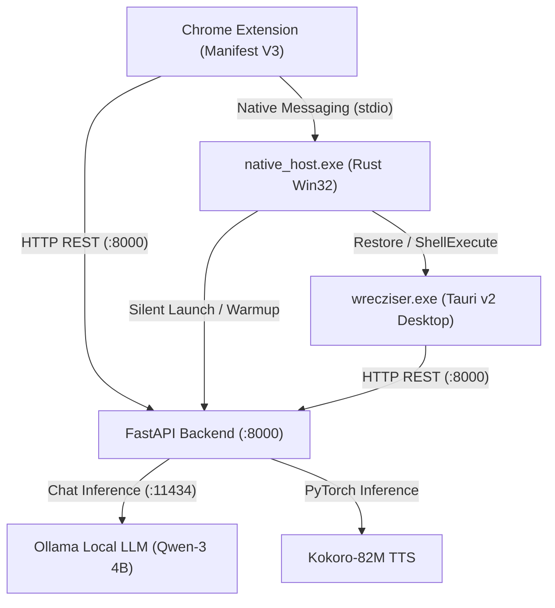

# Wrecziser ⚡

**Wrecziser** is a privacy-first, offline-capable productivity suite designed to summarize web articles, extract job requirements from LinkedIn, target resumes, and read content aloud using high-quality local neural text-to-speech.

All inference runs 100% locally on your machine via **Ollama** and **Kokoro TTS**—no subscriptions, external APIs, or data leakage.

---

## 🌟 Key Features

- **One-Click Page Summaries**: Instantly extracts main content from articles and long-form web pages.
- **LinkedIn Job Intelligence**: Extracts key requirements, required skills, and role expectations directly from job postings.
- **Resume Targeter**: Compares your resume against job postings to find match scores and highlight gaps.
- **Neural Text-to-Speech (TTS)**: Built-in local voice generation with Kokoro-82M.
- **Zero-Friction Background Activation**: Native Windows bridge silently starts and warms up the local backend and Ollama only when needed, staying idle otherwise.
- **Desktop Window UI**: A dedicated, distraction-free desktop application powered by Tauri and Rust.

---

## 🏗️ Architecture

Wrecziser uses a decoupled hybrid architecture: a Chromium extension handles active browser page extraction, a Win32 Rust native messaging host manages daemonless service warmup and window focus, a local FastAPI microservice orchestrates Ollama and Kokoro neural TTS, and a standalone Tauri window provides the full desktop experience.

For an in-depth breakdown of communication protocols, lifecycle sequences, and security boundaries, see [**ARCHITECTURE.md**](ARCHITECTURE.md).



### Directory Tree
```
Wrecziser/
├── Setup.exe                  # Standalone borderless self-extracting GUI installer (14.5MB)
├── install.bat                # Automated setup script (launches Setup.exe)
├── manifest.json              # Chrome Extension (Manifest V3) definition
├── popup.html / popup.js      # Extension popup UI & controller
├── native_host.rs             # Rust source for the Windows Native Messaging Host
├── native_host.exe            # Compiled native host binary (launches backend & app)
├── setup_native_host.bat      # Windows registry & host configuration script
├── wrecziser.exe              # Standalone Tauri desktop window executable
├── ARCHITECTURE.md            # Detailed system design & component specification
│
├── installer/                 # Custom GUI Installer source & assets
│   ├── src-tauri/             # Rust installer backend (thread-isolated setup engine)
│   │   ├── src/lib.rs         # Installer pipeline (extract, Python, Ollama, Qwen, Kokoro)
│   │   ├── capabilities/      # Window control & event permission manifests
│   │   └── payload.zip        # Embedded compressed core application bundle (5.34MB)
│   ├── ui/                    # Borderless Figma-replicated installer frontend (HTML/CSS/JS)
│   └── bundle_payload.py      # Automated payload packaging script
│
├── Wrecziser backend/         # FastAPI local backend services
│   ├── main.py                # API endpoints (/summarize, /health, /api/summary, etc.)
│   ├── summarizer.py          # Summarization business logic & prompts
│   ├── ollama_client.py       # Asynchronous Ollama client with dynamic hardware GPU tuning
│   ├── voice_service.py       # Kokoro neural TTS service
│   ├── screener_service.py    # Candidate screening & resume analysis
│   ├── document_extractor.py  # PDF & text file parsing
│   ├── download_model.py      # Helper to fetch Kokoro model weights
│   ├── requirements.txt       # Python dependencies
│   ├── run_backend.bat        # Interactive backend launcher
│   └── run_backend_silent.vbs # Hidden background backend launcher
│
└── Wrecziser-Window-frontend/ # Tauri desktop frontend source
    ├── src/                   # React / TypeScript UI source
    ├── src-tauri/             # Rust desktop backend & window manager
    └── package.json           # Frontend dependencies
```

---

## 🚀 Getting Started

### ⚡ Fast Track: Standalone Self-Extracting Setup (Recommended)

Simply run:
```cmd
Setup.exe
```
*(Or launch via `install.bat`)*

[`Setup.exe`](Setup.exe) is a **100% standalone single-file installer (14.5 MB)** with zero prerequisites needed on the host PC:
1. **Cinematic Opening Sheen**: Optical cubic-bezier fade-in with left-to-right metallic sheen sweep across the `WRECZ` wordmark (uncluttered borderless window).
2. **Welcome Screen**: Clean Wrecziser introduction with one-click **Get started**.
3. **Internet Verification Modal**: Network sanity check modal dialog (*"check internet connection first then continue"*).
4. **Autonomous Background Setup (Thread-Isolated)**:
   - **Self-Extracts**: Unpacks all core application files into `%LOCALAPPDATA%\Programs\Wrecziser`.
   - **Automated Python 3.11**: Detects Python; if missing, silently downloads and installs Python 3.11 in the background.
   - **Automated Ollama & Qwen**: Checks for Ollama; if missing, installs Ollama, starts `ollama serve`, and pulls the `qwen3:4b-instruct-2507-q4_K_M` (or `qwen2.5:3b`) model.
   - **Virtual Environment & Dependencies**: Provisions `.venv` and pip-installs PyTorch, Kokoro TTS, and FastAPI.
   - **Kokoro Neural Voice Model**: Verifies and downloads the 327MB `kokoro-v1_0.pth` weights.
   - **Windows Integration**: Configures the Chrome Native Messaging Host in Windows Registry (`HKCU\Software\Google\Chrome\NativeMessagingHosts\com.wrecz.wrecziser`).
   - **System Shortcuts**: Automatically pins `Wrecziser.lnk` on your **Desktop** and in the **Start Menu**.
   - **Automatic Guide**: Immediately pops open a clean 3-step Chrome Extension guide in Windows Notepad.
5. **One-Click Launch**: Click **Open** on Frame 61 to launch the desktop application and start local AI services!

---

## ⚡ Dynamic GPU Acceleration (Automatic Hardware Profiling)

`Wrecziser backend/ollama_client.py` includes native hardware profiling that detects discrete NVIDIA GPUs and dynamically tunes Ollama inference for maximum throughput:

- **High-Tier GPU (>= 8 GB VRAM: RTX 3070 / 3080 / 4070 / 4080 / 4090)**:
  - **Context Window**: `16,384 tokens` (handles huge web pages and multi-page resumes).
  - **Prompt Batch Size**: `num_batch: 1024` (**2× to 4× faster prompt evaluation** via Tensor cores).
  - **Full GPU Offloading**: `num_gpu: 99` (forces 100% of transformer layers into VRAM).
  - **Zero Reload Latency**: `keep_alive: "30m"` (pins model hot in VRAM between requests).
- **Mid-Tier GPU (4 GB - 8 GB VRAM: RTX 2050 / 3050 / 3060 / 4050 / 4060)**:
  - `num_ctx: 8192`, `num_batch: 512`, `num_gpu: 99`, `keep_alive: "15m"`.
- **Low-Tier / CPU Fallback (< 4 GB VRAM or integrated graphics)**:
  - `num_ctx: 4096`, `num_batch: 256`, optimal CPU thread allocation (`min(8, os.cpu_count())`).

---

### 📋 System Requirements (for Clean Target Machines)

- **Operating System**: Windows 10 (64-bit) or Windows 11.
- **Internet Connection**: Active connection required during setup for first-time model/package downloads.
- **Free Disk Space**: ~6 to 8 GB (for local LLM weights, Kokoro neural voice, and PyTorch runtime).
- **Permissions**: **Standard user account** (no Administrator / UAC elevation needed).

---

### 🛠️ Manual Step-by-Step Setup (Alternative)

If you prefer to configure components manually:

#### 1. Backend Setup
1. Open a terminal in the `Wrecziser backend` directory:
   ```bash
   cd "Wrecziser backend"
   ```
2. Create and activate a virtual environment:
   ```bash
   python -m venv .venv
   .venv\Scripts\activate
   ```
3. Install required packages:
   ```bash
   pip install -r requirements.txt
   ```
4. *(Optional)* Download offline Kokoro TTS weights (~327MB):
   ```bash
   python download_model.py
   ```
   *(If skipped, the voice service will automatically download the weights from Hugging Face on first use).*

---

### 3. Install the Chrome Extension

1. In Chrome, open `chrome://extensions/`.
2. Toggle on **Developer mode** in the top-right corner.
3. Click **Load unpacked** in the top-left corner.
4. Select the root folder of this project (`Wrecziser`).
5. Copy the **ID** displayed on the extension card (e.g. `iiphddcpdpgkpckolghngefkebjaoaak`).

---

### 4. Register the Native Messaging Host

Run the included setup script from the root folder:

```cmd
setup_native_host.bat
```

- When prompted, paste your Chrome Extension ID (or press Enter to accept the default).
- The script automatically configures `com.wrecz.wrecziser.json` with your folder path and registers it in the Windows Registry (`HKCU\Software\Google\Chrome\NativeMessagingHosts\com.wrecz.wrecziser`).

---

## 🎮 How to Use

1. **Summarize Any Page**:
   - Navigate to any article or web page.
   - Click the **Wreciser** extension icon in your Chrome toolbar.
   - Click **Summarise**. The native host automatically starts the backend and warms up Ollama.
   - Preview the summary directly inside the extension popup or click **Download TXT**.
2. **Open Desktop App**:
   - Click **Open in Wrecziser** from the extension popup.
   - The desktop window (`wrecziser.exe`) will open (or come to the foreground if already open) with the summary loaded.
3. **LinkedIn & Resume Tools**:
   - Use the **LinkedIn Analysis** option on job posts or upload resumes in the desktop interface for skill matching.

---

## ⚙️ Configuration

Copy `Wrecziser backend/.env.example` to `Wrecziser backend/.env` to customize settings:

```env
OLLAMA_HOST=http://127.0.0.1:11434
OLLAMA_MODEL=qwen3:4b-instruct-2507-q4_K_M
SERVER_HOST=127.0.0.1
SERVER_PORT=8000
MAX_CONTENT_CHARS=8000
REQUEST_TIMEOUT=240.0
```

---

## 🛠️ Building from Source

### Native Host Binary
```cmd
rustc -C opt-level=3 -O native_host.rs -o native_host.exe
```

### Tauri Desktop Window
```cmd
cd Wrecziser-Window-frontend
npm install
npm run tauri build
```
The compiled executable will be located in `src-tauri/target/release/wrecziser.exe`.

---

## 🔒 Privacy & Security

- All AI inference occurs strictly on your local hardware via Ollama and Kokoro.
- No telemetry, analytics, or external API calls are made.
- Native messaging only communicates between your trusted local extension and local host.

---

## 📄 License

MIT License. See [LICENSE](LICENSE) for details.
